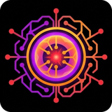
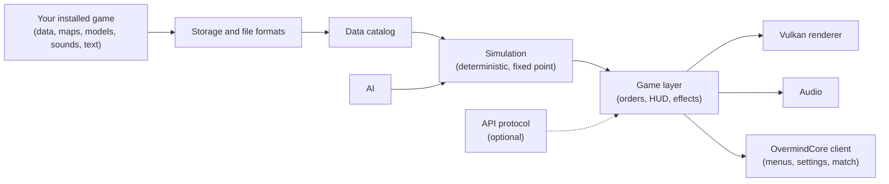

<p align="center">
  
</p>

<h1 align="center">OvermindCore</h1>

<p align="center">
  An open-source recreation of a classic science-fiction real-time-strategy engine,<br>
  written from scratch in C++17 with a Vulkan renderer.
</p>

<p align="center">
  
  
  
  
  
</p>

OvermindCore ships no original game code and no original game assets. It reads the data of a copy of the game
that you own and have installed - units, maps, models, textures, sounds, text and AI scripts - at runtime, from
your own installation. Nothing from that installation is copied into this repository.

## Requirements

<p>
  
  
  
</p>
<p>
  
  
  
  
  
  
</p>

The game folder is the one that contains `SC2Data`. Install the MSYS2 packages:

```bash
pacman -S mingw-w64-ucrt-x86_64-gcc mingw-w64-ucrt-x86_64-cmake mingw-w64-ucrt-x86_64-ninja \
          mingw-w64-ucrt-x86_64-pkgconf mingw-w64-ucrt-x86_64-protobuf
```

`protobuf` is only needed for the optional API protocol support.

## Build

```bash
cmake -S . -B build -G Ninja -DCMAKE_BUILD_TYPE=Release
cmake --build build --target overmindcore
```

The client is written to `build/overmindcore_v<version>-<stage>.exe`. On first start it asks for your game
installation folder and remembers it in `%APPDATA%\OvermindCore\config.txt`.

The public machine-learning API protocol is supported as an optional build feature (`-DOMC_API=ON` / `OFF`).

## Architecture



## Interoperability identifiers

To find and read your installation, the engine uses the file and folder names of the original game's data
(for example the data folder and the map file extension). They are collected in
`include/omc/app/install_ids.hpp`.

## Licence

OvermindCore is licensed under the GNU General Public License v3.0 or later
(SPDX-License-Identifier: GPL-3.0-or-later); see `LICENSE`. Third-party components and their licences are listed
in `THIRD_PARTY_NOTICES.md`. The licence covers only this project's code and art; it grants no rights to the
original game's code, data or assets.
